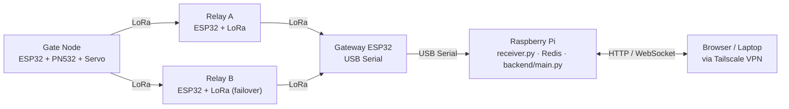

# Sat Set Tap

> Sistem manajemen akses event berbasis IoT — menggantikan QR/gelang dengan tap e-KTP via LoRa mesh network.


---

## Latar Belakang

Sistem gate event konvensional memiliki dua masalah utama:

- **Antrean lambat** — scan QR membutuhkan 3–10 detik per orang
- **Jaringan tidak stabil** — WiFi/4G sering overload di lokasi event ramai

Sat Set Tap menyelesaikan keduanya: e-KTP sebagai token masuk (tap < 1 detik) dan LoRa mesh sebagai infrastruktur jaringan yang bebas internet.

---

## Arsitektur

Alur: Tap e-KTP → gate ESP32 → LoRa mesh → gateway → Raspberry Pi (Redis + FastAPI) → dashboard browser.



**Lihat juga:** [docs/architecture.md](docs/architecture.md) — topologi detail, alur data & komponen server.

---

## Struktur Repository

```
Sat-Set-Tap/
├── firmware/                    # Kode Arduino/ESP32
│   ├── gate_node/               # Node gate + PN532 + Servo
│   ├── relay_node/              # Node relay failover
│   ├── gateway/                 # Gateway USB Serial ke RPi
│   └── registration/            # Arduino reader H-1
├── raspi/                       # Kode Raspberry Pi
│   ├── backend/                 # FastAPI backend (API + WebSocket)
│   ├── frontend/                # Dashboard web (static files)
│   ├── receiver/                # Core packet processing
│   ├── setup/                   # Systemd service + setup script
│   ├── simulate_event.py        # Simulasi event via virtual serial
│   └── requirements.txt
├── tests/                       # Unit tests + benchmark
└── docs/                        # Dokumentasi modular
```

| Dokumentasi | Isi |
|-------------|-----|
| [docs/architecture.md](docs/architecture.md) | Topologi, alur data, komponen server |
| [docs/hardware.md](docs/hardware.md) | Daftar komponen hardware per node |
| [docs/wiring.md](docs/wiring.md) | Diagram wiring semua node + gambar |
| [docs/packet-format.md](docs/packet-format.md) | Format packet 12 byte / 24 hex + CRC-16 |
| [docs/deployment.md](docs/deployment.md) | Setup RPi, Redis AOF, systemd, `.env` |
| [docs/dashboard.md](docs/dashboard.md) | Fitur Ops View & Data View |
| [docs/security.md](docs/security.md) | Keamanan & deteksi anomali |
| [docs/roadmap.md](docs/roadmap.md) | Pengembangan lanjutan (NFC self-registration) |

---

## Setup Cepat

Asumsi target deployment di `/home/pi/sat-set-tap`, user `pi`.

```bash
git clone https://github.com/ccit-venture/sat-set-tap.git /home/pi/sat-set-tap
cd /home/pi/sat-set-tap && git checkout master
bash raspi/setup/setup_raspi.sh        # install Redis, deps, .env, systemd service
```

Akses dashboard: `http://<tailscale-ip>:8080`

Panduan lengkap (manual, Redis AOF, service systemd) → [docs/deployment.md](docs/deployment.md)

---

## Cara Pakai

### Hari H-1 — Registrasi Peserta

**Opsi A: Import CSV massal dari Data View**

Buka `http://<IP>:8080/data.html` → tab Peserta → Import CSV.

Format CSV:
```
uid,name,token_max
A1B2C3D4,Budi Santoso,3
E5F6A7B8,Siti Rahayu,3
```

**Opsi B: Registration Station (Arduino + PN532)**

```bash
python3 raspi/receiver/registration_station.py \
  --serial /dev/ttyUSB0 \
  --redis-pass <pass> \
  --tokens 3
```

Tempelkan KTP ke reader → UID tersimpan otomatis.

### Hari H — Event Berlangsung

Receiver dan dashboard jalan otomatis via systemd. Akses:

- **Ops View** — `http://<IP>:8080` — untuk operator gate
- **Data View** — `http://<IP>:8080/data.html` — untuk panitia

---

## Simulasi Event (Testing)

```bash
# Terminal 1 — virtual serial port
socat -d -d pty,raw,echo=0 pty,raw,echo=0

# Terminal 2 — receiver dengan slave port
python3 raspi/receiver/receiver.py --serial /dev/pts/X --redis-pass <pass>

# Terminal 3 — simulator dengan master port
python3 raspi/simulate_event.py \
  --port /dev/pts/Y \
  --redis-pass <pass> \
  --uids 100 \
  --gates 2 \
  --duration 10
```

---

## Testing

```bash
# Unit test packet parser (tanpa Redis)
python3 tests/test_packet.py

# Benchmark pipeline (mock Redis, tanpa server)
python3 tests/pipeline_benchmark.py --gates 2 --uids 20 --duration 3

# Test koneksi RPi (butuh Redis jalan)
python3 tests/test_raspi.py

# Stress test (butuh Redis jalan)
python3 tests/stress_test.py --gates 2 --uids 50 --duration 10
```

---

## Kontribusi

Project ini **open source** — kontribusi sangat terbuka! Cara paling cepat:

1. **Fork** repository
2. Buat branch fitur: `git checkout -b feature/nama-fitur`
3. Jalankan test: `python3 tests/test_packet.py`
4. Buat **Pull Request** dengan mengisi template yang sudah disediakan

Panduan lengkap (clone, sinkron upstream, gaya commit, aturan dokumentasi) →
[CONTRIBUTING.md](CONTRIBUTING.md)

Komunitas berpegang pada [Kode Etik](CODE_OF_CONDUCT.md). Untuk masalah
keamanan, jangan buka issue publik — lihat [SECURITY.md](SECURITY.md).

---

## Roadmap

- **NFC Self-Registration** *(in progress)* — peserta bisa daftar e-KTP mandiri dari HP via Web NFC API

Detail → [docs/roadmap.md](docs/roadmap.md)

---

## Kontributor

| Nama | Peran |
|------|-------|
| Muhammad Yanuar Andrianto Putra | Network, RPi, Redis, Backend, Dashboard |
| Rezan Dzaky Ambrita | Hardware, ESP32, LoRa, PN532 |

**Pembimbing:** Pak Hudya  
**Institusi:** CEP CCIT-FTUI

---

## Lisensi

MIT License — bebas digunakan dengan menyertakan atribusi.

---

<p align="center">
  <sub>Sat Set Tap · Venture Studio CCIT-FTUI</sub>
</p>