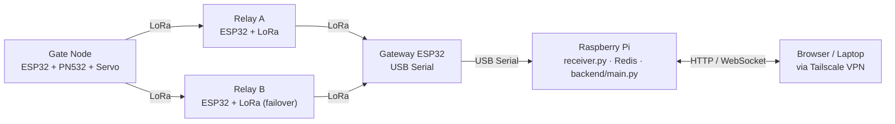
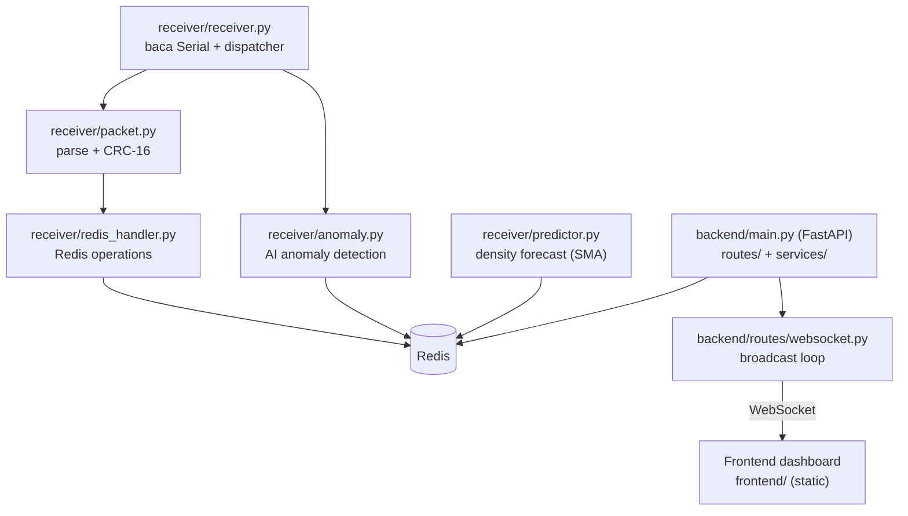

# Arsitektur Sistem

> Dokumen ini menjelaskan arsitektur **Sat Set Tap** secara lengkap: topologi jaringan,
> alur data dari tap e-KTP sampai dashboard, serta komponen server.

---

## Topologi Jaringan



### Keterangan Node

| Node | Hardware | Fungsi |
|------|----------|--------|
| **Gate Node** | ESP32 + LoRa SX1278 + PN532 + Servo SG90 | Baca UID e-KTP, kirim packet tap, buka/tutup gate |
| **Relay Node** | ESP32 + LoRa SX1278 | Forward packet dengan pengurangan hop count (mesh failover) |
| **Gateway** | ESP32 + LoRa SX1278 | Terima packet dari mesh, kirim ke RPi via USB Serial |
| **Raspberry Pi** | RPi 4 + Redis + Python | Server: process packet, simpan state, serve API/dashboard |

---

## Alur Data Tap

Urutan lengkap sejak peserta menempelkan e-KTP di gate sampai muncul di dashboard:

```mermaid
sequenceDiagram
    autonumber
    participant Gate as Gate Node (ESP32)
    participant Relay as Relay Node (ESP32)
    participant GW as Gateway (ESP32)
    participant RPi as Raspberry Pi (receiver)
    participant Redis as Redis DB
    participant Backend as Backend (FastAPI)
    participant WS as WebSocket Manager
    participant UI as Dashboard (Browser)

    Gate->>Gate: PN532 baca UID e-KTP
    Gate->>Relay: LoRa packet TAP_REQUEST<br/>(12 byte / 24 hex, hop=3)
    Relay->>GW: LoRa forward (hop berkurang)
    GW->>RPi: Serial "DATA:&lt;hex&gt;:&lt;rssi&gt;"
    RPi->>Redis: store_tap (cek token, log event)
    RPi-->>GW: Serial "RESP:&lt;hex&gt;" (OK/DENY)
    GW-->>Relay: LoRa response
    Relay-->>Gate: LoRa response
    RPi->>Redis: update stats & anomaly state
    Backend->>Redis: baca stats, analytics, network, forecast
    Backend->>WS: broadcast snapshot (1 detik)
    WS->>UI: live update Ops View / Data View
```

---

## Komponen Server (Raspberry Pi)



Detail lebih lanjut:
- Format packet → [packet-format.md](packet-format.md)
- Komponen hardware → [hardware.md](hardware.md)
- Deployment RPi → [deployment.md](deployment.md)