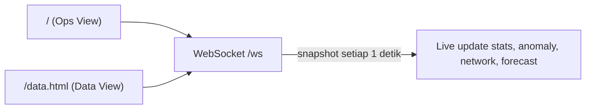
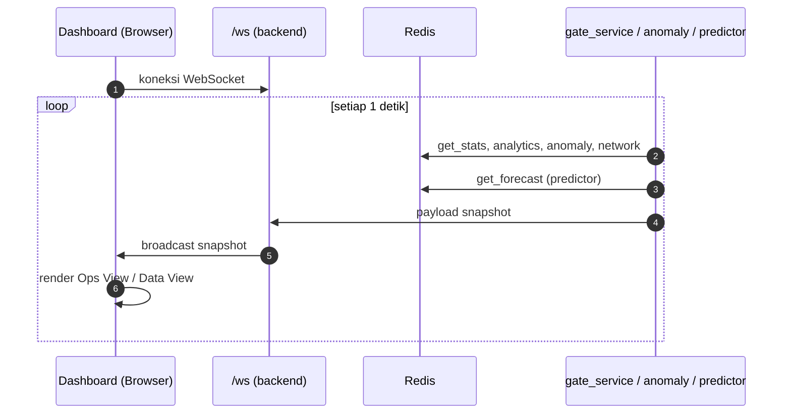

# Dashboard

> Dokumentasi fitur dashboard web Sat Set Tap — terdiri dari dua tampilan utama:
> **Ops View** (untuk operator gate) dan **Data View** (untuk panitia/admin).

Dashboard di-serve langsung oleh backend FastAPI
(`app.mount("/", StaticFiles(directory="frontend", html=True))`) — tidak perlu
menjalankan frontend terpisah.

---

## Struktur Halaman

---

## Ops View (`/`)

Untuk **operator gate** — monitoring realtime dari jarak jauh.

| Fitur | Keterangan |
|-------|------------|
| Stats realtime | Terdaftar, sudah masuk, total tap, gate online |
| Security Monitor | 4 jenis anomali: TAILGATING, UNKNOWN_FLOOD, RAPID_CROSS_GATE, GATE_SILENT |
| AI Forecast | Prediksi kepadatan per gate 5 menit ke depan (HIGH/MED/LOW) |
| Network Status | Latency + RSSI signal bars per gate |
| Gate Cards | Status online/offline, total tap, lockdown control |
| Lockdown | Kunci/buka gate dari jarak jauh — auto-lockdown saat anomali HIGH |
| Chart | Frekuensi tap per menit per gate |
| Ticker | 3 event tap terbaru secara realtime |

---

## Data View (`/data.html`)

Untuk **panitia/admin** — manajemen data dan kontrol penuh.

| Tab | Fitur |
|-----|-------|
| Peserta | Tabel semua UID + search + filter (Semua/Masuk/Belum/Token Habis) |
| Peserta | Import CSV massal, Export peserta, Manual Check-In, Revoke UID |
| Event Log | 1000 entri terakhir + filter status + filter gate + Export log |
| Kontrol | Flush Event (ketik `RESET_LOG`) + Flush Semua (ketik `HAPUS_SEMUA`) |
| Kontrol | Lockdown/Unlock semua gate + status per gate |

---

## Alur Data WebSocket

---

## Manual Check-In

Dari Data View → tab Peserta, panitia bisa melakukan check-in manual dengan endpoint
`POST /api/register/{uid}/checkin`. Berbeda dengan tap normal, event ini ditandai
`manual: true` di log sehingga bisa diaudit (lihat `raspi/backend/routes/participants.py`).

---

## File Terkait

| Path | Isi |
|------|-----|
| `raspi/frontend/index.html` | Ops View |
| `raspi/frontend/data.html` | Data View |
| `raspi/frontend/style.css` | Styling (dark/light mode) |
| `raspi/frontend/app.js` | WebSocket, fetch, render |
| `raspi/backend/routes/websocket.py` | Endpoint `/ws` + broadcast loop |
| `raspi/backend/routes/stats.py` | Endpoint `/api/stats`, `/api/analytics`, `/api/network` |