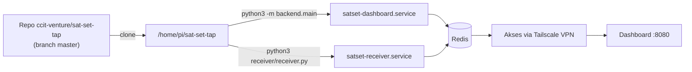
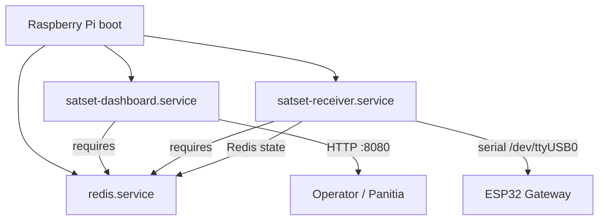

# Deployment & Instalasi

> Panduan lengkap deployment Sat Set Tap di Raspberry Pi, konfigurasi environment,
> dan cara menjalankan receiver + backend.

---

## Persyaratan

- Raspberry Pi (RPi 4 disarankan)
- Redis 6.x + AOF persistence
- Python 3.9+
- Tailscale (untuk akses remote)
- Repo di-clone dari `git@github.com:ccit-venture/sat-set-tap.git` (branch `master`)

---

## Model Deployment



---

## Setup Satu Kali (`setup_raspi.sh`)

Asumsi deploy di `/home/pi/sat-set-tap`, user `pi`:

```bash
# Clone repo (branch master)
git clone https://github.com/ccit-venture/sat-set-tap.git /home/pi/sat-set-tap
cd /home/pi/sat-set-tap
git checkout master

# Install Redis, dependencies, buat .env, dan aktifkan systemd service
bash raspi/setup/setup_raspi.sh
```

Script ini akan:
1. Install Redis + Python dependencies (`raspi/requirements.txt`)
2. Enable & start Redis saat boot
3. Salin `raspi/backend/.env.example` → `raspi/backend/.env` (jika belum ada)
4. Install & start `satset-dashboard.service` + `satset-receiver.service`

---

## Manual (langkah demi langkah)

### 1. Raspberry Pi

```bash
# Clone repo (branch master)
git clone https://github.com/ccit-venture/sat-set-tap.git
cd sat-set-tap
git checkout master

# Install Python dependencies
pip3 install -r raspi/requirements.txt

# Buat file config dari template
cp raspi/backend/.env.example raspi/backend/.env
nano raspi/backend/.env  # isi REDIS_PASS, SERIAL_PORT, dll

# Install systemd services (auto-start saat boot)
sudo cp raspi/setup/satset-dashboard.service /etc/systemd/system/
sudo cp raspi/setup/satset-receiver.service  /etc/systemd/system/
sudo systemctl daemon-reload
sudo systemctl enable satset-dashboard satset-receiver
sudo systemctl start  satset-dashboard satset-receiver
```

Akses dashboard: `http://<tailscale-ip>:8080`

### 2. Redis AOF Persistence

Agar data tidak hilang saat RPi mati mendadak:

```bash
sudo nano /etc/redis/redis.conf
```

Ubah:
```
appendonly yes
appendfsync everysec
```

```bash
sudo systemctl restart redis
```

### 3. Konfigurasi `.env`

Salin `raspi/backend/.env.example` menjadi `raspi/backend/.env`, lalu isi:

| Variabel | Default | Keterangan |
|----------|---------|------------|
| `REDIS_HOST` | `localhost` | Host Redis |
| `REDIS_PORT` | `6379` | Port Redis |
| `REDIS_PASS` | (kosong) | Password Redis (wajib untuk keamanan) |
| `SERIAL_PORT` | `/dev/ttyUSB0` | Port serial gateway ESP32 |
| `DASHBOARD_PORT` | `8080` | Port HTTP dashboard/API |
| `TOKEN_DEFAULT` | `3` | Default token per peserta |

---

## Menjalankan dengan Systemd

Service disediakan di `raspi/setup/`:

| Service | Deskripsi | ExecStart |
|---------|-----------|-----------|
| `satset-dashboard.service` | Backend API + Dashboard | `python3 -m backend.main` |
| `satset-receiver.service` | Receiver LoRa → Redis | `python3 receiver/receiver.py --serial /dev/ttyUSB0 --redis-pass <pass>` |

Semua service menggunakan `WorkingDirectory=/home/pi/sat-set-tap/raspi` dan
`EnvironmentFile=/home/pi/sat-set-tap/raspi/backend/.env`.

**Catatan:** Jika path deploy berbeda, ubah di **kedua** `.service` file dan `setup_raspi.sh`
secara bersamaan.

```bash
# Cek status & log
sudo systemctl status satset-dashboard satset-receiver
journalctl -u satset-receiver -f
```

---

## Menjalankan Manual (tanpa systemd)

```bash
# Backend (dashboard) — dari dalam raspi/
cd raspi
python3 -m backend.main          # atau: uvicorn backend.main:app --port 8080

# Receiver (baca serial ESP32 gateway)
python3 receiver/receiver.py --serial /dev/ttyUSB0 --redis-pass <pass>
python3 receiver/receiver.py --mock            # tanpa hardware
```

---

## Arsitektur Service

