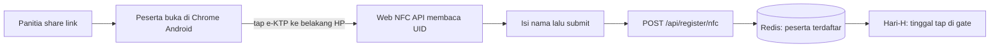

# Roadmap & Pengembangan Lanjutan

> Daftar fitur yang sedang atau akan dikembangkan di luar inti sistem saat ini.

---

## NFC Self-Registration *(In Progress)*

Peserta dapat mendaftarkan e-KTP mandiri dari HP masing-masing tanpa perlu datang
ke booth registrasi H-1.

### Flow

### Stack

- Web NFC API (Chrome Android 89+)
- PWA — tidak perlu install aplikasi
- Endpoint baru: `POST /api/register/nfc`
- Token registrasi untuk validasi peserta yang berhak daftar

### Keunggulan

- Tidak ada antrean di booth H-1
- Panitia tidak perlu standby di registration station
- Peserta bisa daftar kapan saja sebelum hari event

### Keterbatasan

- iOS tidak support Web NFC (restriksi Apple)
- Hanya bisa di Chrome Android 89+

### Status

Dalam pengembangan.

---

## Ide Lanjutan Lainnya

- Autentikasi dashboard (login panitia/admin) untuk deployment publik
- Logging & monitoring terpusat
- Ekspor laporan event otomatis (PDF/Excel)