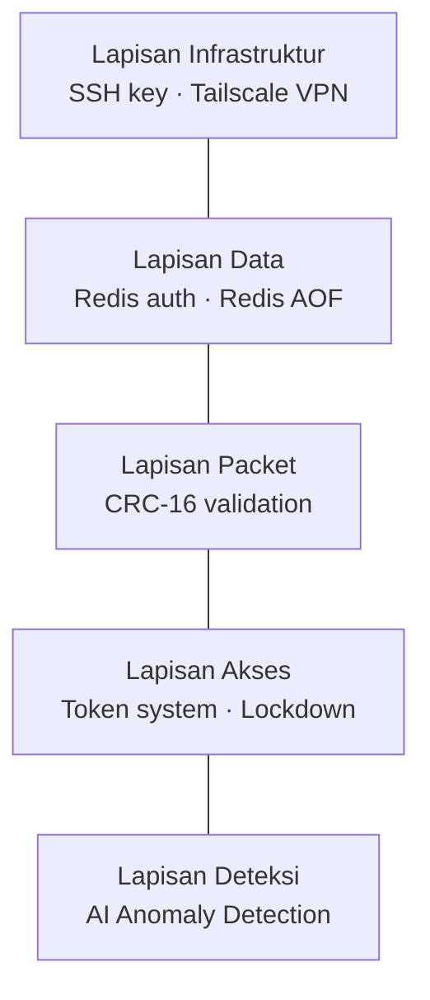
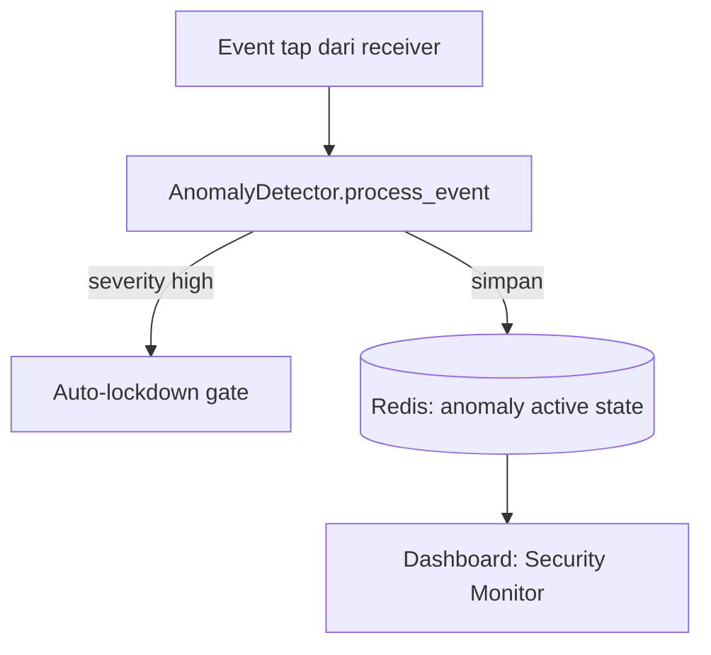

# Keamanan

> Daftar langkah keamanan yang diterapkan pada sistem Sat Set Tap — mulai dari
> jaringan, penyimpanan, sampai proteksi akses gate.

---

## Lapisan Keamanan

---

## Infrastruktur

- **SSH Key** — password login dinonaktifkan, hanya key-based
- **Tailscale VPN** — akses remote hanya via jaringan privat (dashboards & Redis bind ke Tailscale IP)

## Data (Redis)

- **Redis auth** — password wajib, bind ke Tailscale IP
- **Redis AOF** — persistensi data saat RPi mati mendadak

## Packet

- **CRC-16** — setiap packet divalidasi, packet corrupt dibuang di `receiver/packet.py`

## Akses Gate

- **Token system** — setiap UID punya kuota masuk terbatas (`token_max` / `token_left`)
- **Auto-lockdown** — gate otomatis dikunci saat anomali HIGH terdeteksi
- **Lockdown block** — tap diblock di receiver saat gate sedang lockdown
- **Admin override** — unlock manual oleh admin tidak bisa di-override anomali selama 30 menit

## Deteksi Anomali (AI Statistical)

4 jenis anomali yang dipantau realtime oleh `receiver/anomaly.py`:

| Tipe | Deskripsi | Threshold |
|------|-----------|-----------|
| `TAILGATING` | UID sama tap < 30 detik (ikut masuk) | interval < 30 detik |
| `UNKNOWN_FLOOD` | > 3 UID tidak terdaftar dalam 2 menit (probing) | > 3 UID / 120 detik |
| `GATE_SILENT` | Gate tidak heartbeat dalam 5 menit (node down) | > 300 detik |
| `RAPID_CROSS_GATE` | UID masuk Gate A, < 2 menit tap Gate B (credential sharing) | < 120 detik |

State anomali disimpan di Redis (`gate:anomaly:active:*`, `gate:lockdown:active`)
sehingga bisa di-share antar proses (receiver + backend).

---

## Pertimbangan untuk Produksi

- Ganti password default Redis dan token default (`TOKEN_DEFAULT` di `.env`).
- Pastikan firewall hanya membuka port yang diperlukan.
- Hanya izinkan akses dashboard lewat Tailscale, jangan expose ke internet publik
  tanpa autentikasi tambahan.